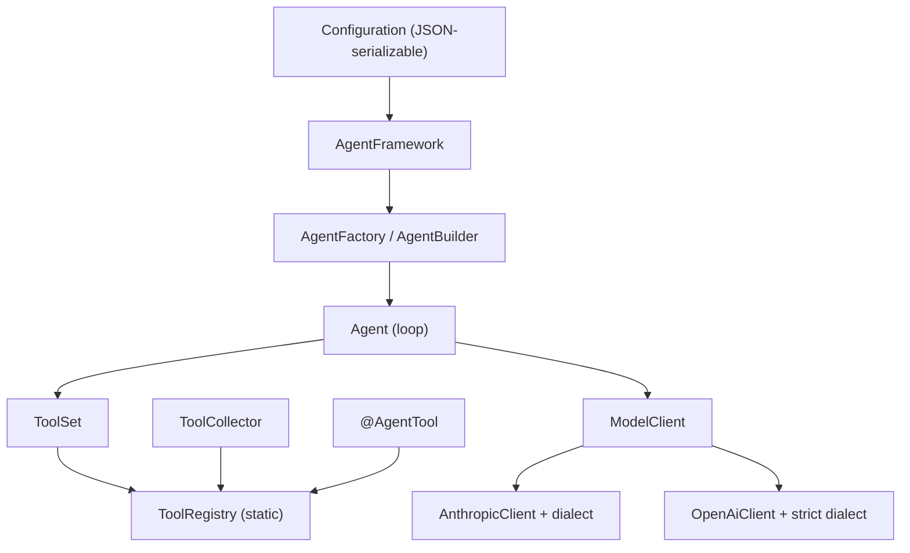
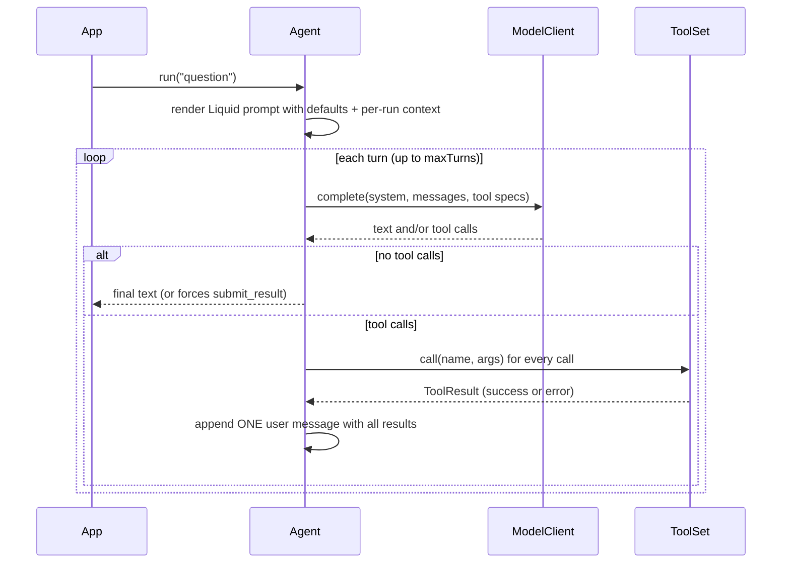

# Architecture

## Layers

| Layer          | Source                                          | Responsibility                                                                    |
| -------------- | ----------------------------------------------- | --------------------------------------------------------------------------------- |
| Tool creation  | `src/tools/tool-decorator.ts`                   | `@AgentTool` stamps metadata on a class and registers it                          |
| Tool discovery | `src/tools/tool-collector.ts`                   | Imports modules so decorators run                                                 |
| Tool registry  | `src/tools/tool-registry.ts`                    | Static store of tool classes and cached instances                                 |
| Tool execution | `tool-set.ts`, `tool-runner.ts`, `tool-lint.ts` | Select tools by name, lint, validate arguments, execute, convert failures to data |
| Model types    | `src/model/`                                    | Provider-agnostic messages, content blocks, request/response, `ModelClient`       |
| Agent runtime  | `src/agent/`                                    | The loop, the builder, config-to-agent factory                                    |
| Providers      | `src/providers/`                                | SDK adapters and dialects                                                         |
| Config schemas | `src/schema/json-schema-loader.ts`              | Compiles persisted JSON Schema into Zod                                           |
| Entry point    | `src/agent-framework.ts`                        | Config loading, runtime registration, agent construction                          |

## Design rules

1. **One schema, two uses.** A tool's Zod schema is the validator _and_ (through `z.toJSONSchema`) the schema
   advertised to the model. Both come from the same object, so they cannot disagree.
2. **Errors are data.** Bad arguments, unknown tools, unparseable model output and invalid structured results are
   turned into error results and shown to the model so it can retry. The loop only fails when it runs out of
   budget. See [Error handling](./error-handling.md).
3. **Discovery never instantiates.** Collecting tools imports modules (decorators register classes). Instances are
   created lazily, on first use, and cached.
4. **Agents reference tools by name.** The registry holds everything that was discovered; an agent's
   configuration decides what it is allowed to use.
5. **Configuration is data.** Agent and provider configs are validated Zod schemas, so they can be loaded from
   files, databases or HTTP requests.
6. **Provider-agnostic loop.** `Agent` only talks to `ModelClient`. Differences between providers live in the
   adapters and their dialects.
7. **Immutability.** Messages, requests, tool sets and results copy their inputs into readonly structures.

## Lifecycle of a request

Details of each branch are in [Agents: the loop](./agents.md#the-loop).

## Module map and statefulness

- **Global, process-wide state:** `ToolRegistry` (classes and cached instances). This is deliberate: decorators
  run at import time and have nowhere else to register. Tests isolate with `clearToolClasses()` and
  `clearToolInstances()`.
- **Per `AgentFramework` instance:** the provider and agent config maps. Registering an agent only affects that
  framework object.
- **Per call:** `framework.agent(name)` builds a new, stateless `Agent` (and a new model client) every time.
  An `Agent` holds a parsed Liquid prompt and default context, but no conversation state; conversations live in
  the transcript you pass in and get back. Per-run context overrides defaults in a fresh Liquid scope and the
  rendered prompt is reused for every turn.

## Non-goals

Streaming, multi-agent orchestration, recursive (`$ref`/`$defs`) output schemas and a persistence layer for
runtime-registered agents are not implemented.
